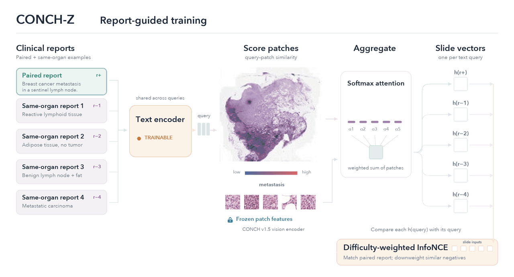

<div align="center">

# CONCH-Z

### The text encoder for CONCH v1.5

[](#citation)
[](https://huggingface.co/MahmoodLab/CONCH-Z)
[](https://github.com/mahmoodlab)

**Beyond Sparse Captions: Aligning Slide-Level Text and Patch-Level Vision in Pathology**  
**NeurIPS 2026 · Spotlight**

Daniel Shao\*, Dongmin Bang\*, Luca L. Weishaupt, Sophia J. Wagner, Nic G. Reitsam,  
Ming Y. Lu, Long P. Le, Richard J. Chen†, Faisal Mahmood†

<sub>\*Co-first authors · †Co-senior authors</sub>

[**Model weights**](https://huggingface.co/MahmoodLab/CONCH-Z) · [**Quickstart**](#installation--access) · [**Results**](#results-zero-shot-patch-level-classification) · [**Citation**](#citation)

</div>

---

**CONCH-Z brings text encoding and zero-shot classification to [CONCH v1.5](https://huggingface.co/MahmoodLab/conchv1_5).** The previous CONCH v1.5 release provided only the vision encoder. CONCH-Z pairs that same vision encoder, unchanged, with an aligned text tower, so you can compare pathology image patches with natural-language class descriptions without training a task-specific classifier.

- **CONCH-Z can directly replace CONCH v1.5.** The vision encoder is identical, so you don't need to re-extract patch features you already have from CONCH v1.5 (e.g. via [Trident](https://github.com/mahmoodlab/trident) or TITAN's `return_conch()`).
- CONCH-Z adds a text tower and the CONCH v1.5 image **projection layer** (`proj_contrast`), which the public CONCH v1.5 release leaves out. Projected image features and text embeddings share one space, which enables zero-shot classification.

> [!NOTE]
> This release focuses on using **CONCH-Z**. Code for **LIMIT training** is coming soon.

## From clinical reports to zero-shot predictions

CONCH-Z is trained with **LIMIT** (**L**ocked **I**mage **M**ultiple **I**nstance Pre**T**raining), which aligns the text encoder to a frozen visual space using approximately **335,000 clinical pathology reports**. The image tower stays frozen and only the text tower is trained. At inference, candidate class descriptions become text queries for zero-shot classification.

<div align="center">
  
  <br>
  <sub>LIMIT training and zero-shot slide inference. Tissue regions follow the paper's annotations; animated scores and attention are illustrative.</sub>
</div>

## Installation & access

The model is gated on Hugging Face. Request access on the [model page](https://huggingface.co/MahmoodLab/CONCH-Z), then log in:

```bash
pip install torch torchvision timm transformers huggingface_hub
huggingface-cli login
```

## Loading the model

```python
import torch
from transformers import AutoModel

model = AutoModel.from_pretrained("MahmoodLab/CONCH-Z", trust_remote_code=True)
model = model.eval().to("cuda")
```

The model has three parts:

| Component | Role |
|---|---|
| Vision encoder | Same as CONCH v1.5 (ViT-L/16 + attentional pooler). Maps a patch to the 768-d feature that the public CONCH v1.5 release and Trident's `conch_v15` encoder output. |
| Image projection (`visual.proj_contrast`) | A 768 × 768 linear map from CONCH v1.5 features into the shared image-text space. It is CONCH v1.5's own contrastive head, kept frozen during LIMIT, but it is not part of the public CONCH v1.5 weights. |
| Text encoder | New in CONCH-Z. Maps a prompt to a 768-d embedding in the shared space. |

> [!IMPORTANT]
> Image features must pass through the projection before you compare them with text. `encode_image` does this for you. For CONCH v1.5 features computed elsewhere, call `model.project_image_features` first. If you skip it, zero-shot accuracy falls below chance: SPIDER-C balanced accuracy drops from 58.8 to 10.3.

## Encoding images

```python
from PIL import Image

image = Image.open("patch.png").convert("RGB")
image = model.eval_transform(image).unsqueeze(0).to("cuda")   # (1, 3, 448, 448)

with torch.inference_mode():
    image_emb = model.encode_image(image)                      # (1, 768), projected and L2-normalized
```

`encode_image` runs the vision encoder and then the projection. To get the unprojected CONCH v1.5 feature (identical to Trident's `conch_v15` output), use `model.encode_image_features(image)`.

### Using precomputed CONCH v1.5 features

If you already have CONCH v1.5 patch features (for example `.h5` files from Trident's `conch_v15` encoder), you don't need to re-extract them. Project them into the shared space:

```python
import h5py

with h5py.File("slide.h5", "r") as f:
    features = torch.from_numpy(f["features"][:])              # (N, 768) CONCH v1.5 features

with torch.inference_mode():
    image_emb = model.project_image_features(features)         # (N, 768), features @ proj_contrast, L2-normalized
```

## Encoding text

```python
prompts = [
    "a lymph node biopsy containing metastatic breast carcinoma",
    "a lymph node biopsy containing normal lymphoid tissue",
]

with torch.inference_mode():
    input_ids = model.tokenizer(prompts).to("cuda")               # (C, 128)
    text_emb = model.encode_text(input_ids, normalize=True)      # (C, 768)
```

Tip: as in the paper, prepend the tissue or organ type to each class name (e.g. `"breast tissue, invasive ductal carcinoma"`). This usually helps zero-shot accuracy.

## Zero-shot classification

### Option 1: built-in helper

`zero_shot_classifier` builds one L2-normalized embedding per class. It averages over any number of synonyms per class and prompt templates (`CLASSNAME` is replaced by each synonym). `zero_shot` takes projected image embeddings (from `encode_image` or `project_image_features`) and returns softmax probabilities scaled by the model's learned temperature:

```python
classnames = [
    ["metastatic breast carcinoma", "tumor"],     # class 0 synonyms
    ["normal lymph node", "lymphocytes"],         # class 1 synonyms
]
templates = ["CLASSNAME", "an image of CLASSNAME", "lymph node, CLASSNAME"]

with torch.inference_mode():
    classifier = model.zero_shot_classifier(classnames, templates, device="cuda")  # (768, num_classes)
    probs = model.zero_shot(image_emb, classifier)                                 # (N, num_classes)

pred = probs.argmax(dim=-1)
```

### Option 2: project, L2-normalize and multiply

Zero-shot classification is cosine similarity between projected image embeddings and text embeddings. You can compute it directly, which is handy when you already have a large set of precomputed CONCH v1.5 patch features:

```python
import torch.nn.functional as F

proj = model.visual.proj_contrast                           # (768, 768) image projection

image_emb = F.normalize(features.cuda() @ proj, dim=-1)     # (N, 768)  projected patch embeddings
text_emb  = F.normalize(text_emb, dim=-1)                   # (C, 768)  one embedding per class

similarity = image_emb @ text_emb.T                         # (N, C) cosine similarities
pred = similarity.argmax(dim=-1)                            # predicted class per patch
```

## Results: zero-shot patch-level classification

C16 is reported as AUC. SPIDER and CATCH are reported as balanced accuracy, averaged across organs and tasks. The number of classes is in parentheses. Best result in **bold**. See the paper for per-organ results and bootstrap standard deviations.

| Benchmark | PLIP | QuiltNet | MUSK | MI-Zero | CONCH v1.5 | **CONCH-Z** |
|---|---|---|---|---|---|---|
| CAMELYON-16, lymph node (2) | 88.4 | 91.7 | 82.7 | 59.9 | 90.3 | **96.7** |
| SPIDER-C, coarse (7–9 per organ) | 34.8 | 30.1 | 51.3 | 44.2 | 49.7 | **58.8** |
| SPIDER-F, fine-grained (13–24 per organ) | 25.6 | 19.7 | 44.1 | 34.9 | 42.9 | **51.3** |
| CATCH, canine skin (2 / 11) | 49.3 | 48.3 | 59.1 | 51.3 | 47.9 | **64.4** |

## License

The model weights are released under [CC-BY-NC-ND 4.0](https://creativecommons.org/licenses/by-nc-nd/4.0/) for non-commercial academic research only. The model is not validated for clinical diagnosis.

## Citation

If you use CONCH-Z or LIMIT in your research, please cite:

```bibtex
@inproceedings{shao2026limit,
  title     = {Beyond Sparse Captions: Aligning Slide-Level Text and Patch-Level Vision in Pathology},
  author    = {Shao, Daniel and Bang, Dongmin and Weishaupt, Luca L. and Wagner, Sophia J. and Reitsam, Nic G. and Lu, Ming Y. and Le, Long P. and Chen, Richard J. and Mahmood, Faisal},
  booktitle = {Advances in Neural Information Processing Systems},
  year      = {2026},
  url       = {https://github.com/mahmoodlab/LIMIT}
}
```

## Questions

Please open a [GitHub issue](https://github.com/mahmoodlab/LIMIT/issues) for questions about using CONCH-Z.
